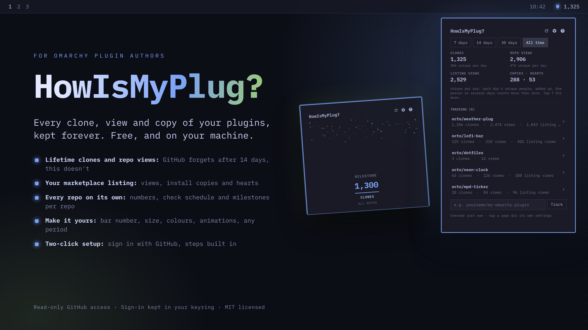

# HowIsMyPlug?



An Omarchy bar plugin for people who publish Omarchy plugins. It shows how your plugins are doing:

- **Clones and repo views** from GitHub, for every repo you track. GitHub only keeps 14 days of
  traffic; HowIsMyPlug? saves each day on your machine, so you keep the full history for free.
- **Listing views, install-command copies and hearts** from your Omarchy marketplace listing.
- **Milestones**: open the dropdown after you pass 100 clones (or any number and stat you pick)
  and it celebrates, once.

Pick a period (7, 14 or 30 days, or all time) and total, unique or both counts in the dropdown.

## Quick start

1. Add the plugin from the Omarchy plugin marketplace, or:
   `omarchy plugin add https://github.com/gsottnick/howismyplug`
2. Open the dropdown and type a repo you own (`owner/repo`). Marketplace numbers show right away.
3. For clones and repo views, click **Sign in with GitHub** (the **?** button in the dropdown shows these
   steps too). The code is copied for you: paste it
   on the page that opens and click Authorize. Then click **Give access** (or **Choose repos**)
   and pick your repos. Picking "All repositories" means you never have to do it again.

That's all. No API key to create, no server, no account with anyone but GitHub.

### Prefer a token?

Click **Use a token instead** and paste a
[fine-grained token](https://github.com/settings/personal-access-tokens/new) with
*Repository permissions → Administration: Read-only* for the repos you track. GitHub files traffic
under "administration"; read-only can't change anything.

## Settings

Everything is in the dropdown. **⚙** opens the settings, **?** the help, and each repo in the list
opens its own page.

**Each repo** (tap it in the list): its own numbers for the chosen period, how often to check GitHub
traffic and the listing (hourly, daily, weekly, every 2 weeks), its own milestones (on/off, which stat,
every how many), and links to the repo and its listing.

**Settings page**:

| Setting | Choices | Default |
| --- | --- | --- |
| Bar number comes from | all repos combined, or any one repo | all repos |
| Bar number shows | clones, unique clones, repo views, unique repo views, listing views, copies, hearts | clones |
| Dropdown size | compact, normal, tall (the height is fixed; long lists scroll) | normal |
| Highlight colour | theme accent, text, alert | accent |
| Clones and views | total, unique, both | both |
| Animations | on, off | on |
| Show combined totals | on, off | on |
| Combined milestones | on/off, which stat, every how many | on, clones, 100 |
| New repos start with | GitHub and listing check intervals | daily, daily |

The period (7, 14, 30 days or all time) is picked at the top of the overview and each repo page. The
same settings also appear in Omarchy's widget settings.

## Good to know

- **History starts when you add a repo**, plus the 14 days GitHub still has at that moment.
- **Totals** (clones, views) add up day by day: each day is stored once and replaced, never added, when
  a later check sees it again, so overlapping 14-day windows can't double count.
- **Unique numbers**: GitHub only counts different people over its latest 14 days. All-time unique adds
  up back-to-back 14-day blocks from the day tracking started, each block being GitHub's own count for
  it (100 in the first block + 20 in the next = 120). Someone who returns in a later block counts again,
  as on GitHub's page, but nobody is ever counted twice within a block. The block in progress only rises
  and lands on GitHub's number when it ends. To read each block exactly, the plugin checks hourly on a
  block's last day and once more at 23:55 UTC, whatever the schedule; at worst someone who first clones
  in a block's final minutes is missed.
  `tests/math.test.mjs` proves all of this against simulated traffic on every schedule.
- **Gaps**: if the computer is off (or the shell isn't running) for more than 14 days, the days
  GitHub dropped in between are gone. The dropdown says which ones.
- **Marketplace numbers** are the marketplace's own lifetime counts; periods show the growth
  since HowIsMyPlug? started watching.
- "Every 2 weeks" checks every 13 days, so no day falls out of GitHub's 14-day window.

## Privacy and security

Your GitHub sign-in stays in your system keyring and only ever goes to GitHub. The app can only
read traffic on the repos you choose, and you can revoke it any time on GitHub
(Settings → Applications). Nothing is sent anywhere else. The full list is in
[SECURITY.md](SECURITY.md).

Where things live:

| What | Where |
| --- | --- |
| GitHub sign-in or token | System keyring (GNOME Keyring), item "HowIsMyPlug? GitHub sign-in" |
| Traffic history | `~/.local/state/howismyplug/history.json` (only you can read it) |
| Settings | Omarchy's `shell.json`, like every bar widget |

To start over: Sign out in the dropdown, then delete `~/.local/state/howismyplug`.

## Development

```bash
node --test 'tests/*.test.mjs'           # logic + security rules
python3 -m venv .venv-harness && .venv-harness/bin/pip install 'PySide6>=6.10,<6.12'
cd tests && ../.venv-harness/bin/python -m unittest panel_test -v   # the real panel, fake GitHub
omarchy plugin validate .
```

The panel tests run the real QML against a local fake of GitHub and the marketplace and a fake
`secret-tool`, so they never touch your account or keyring. `tools/preview/make-preview.py`
rebuilds `preview.png`.

## License

MIT
